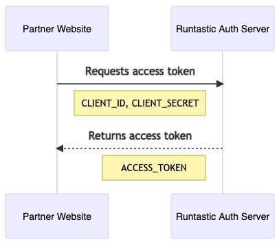

# Partner Authentication

Some entities from the Partner API are not related to an user. The endpoints from these
entities won't require the access token from the [Partner on behalf of user flow](partner_in_behalf_of_user.md),
but one that can be issued only by sending both the `CLIENT_ID` and the `CLIENT_SECRET`.

Once you have the access token, you can perform authenticated API requests adding the
`Authorization` header to the requests:

```http
Authorization: Bearer {ACCESS_TOKEN}
```

## Issuing an access token

The flow to get an access token is pretty straightforward.



<!-- 
sequenceDiagram
Partner Website->>Running App Auth Server: Requests access token
Note right of Partner Website: CLIENT_ID, CLIENT_SECRET
Running App Auth Server->>Partner Website: Returns access token
Note left of Running App Auth Server: ACCESS_TOKEN
-->

### Request

#### Endpoint

`POST https://accounts.runtastic.com/v1/as/token.oauth2`

#### Headers

Content-Type: `application/x-www-form-urlencoded`

#### Body

| Attribute         | Type       | Description                                        |
| ----------------- | ---------- | -------------------------------------------------- |
| **client_id**     | **String** | The `CLIENT_ID` from the Partner                   |
| **client_secret** | **String** | The `CLIENT_SECRET` from the Partner               |
| **grant_type**    | **String** | It must always have the value `client_credentials` |

### Response

#### Headers

Content-Type: `application/json`

#### Body

| Attribute        | Type        | Description                             |
| ---------------- | ----------- | --------------------------------------- |
| **access_token** | **String**  | 128 characters length                   |
| **expires_in**   | **Integer** | Seconds left to expire the access token |
| **token_type**   | **String**  | It will always have the value `Bearer`  |

### HTTP Codes

| HTTP code  | Description                         |
| ---------- | ----------------------------------- |
| 200 OK     | Access Token was issued successfuly |

Example:

```shell
http -f https://accounts.runtastic.com/v1/as/token.oauth2 \
grant_type=client_credentials \
client_id={CLIENT_ID} \
client_secret={CLIENT_SECRET}
```

```http
HTTP/1.1 200 OK
Content-Type: application/json;charset=utf-8

{
    "access_token": "XVVM919iy5C4IYuDEweXfrPwR5nKKURkMjkR4ax4C1S0TIeHblE3FthUDtKnimGcUIDkKI1zAW0leWhyVRyOXm7cF8z4Z3mEZvWsTC0tjC9472Z6EnJqgYSy3uGkpfpi",
    "expires_in": 7199,
    "token_type": "Bearer"
}
```

## Revoking an access token

Access tokens can be easily revoked. It's advisable to revoke them after usage.

```sequence-diagram
Partner Website->Running App Auth Server: Revokes access token
Note right of Partner Website: CLIENT_ID, CLIENT_SECRET, TOKEN
Running App Auth Server-->Partner Website: 200 OK
```

### Request

#### Endpoint

`POST https://accounts.runtastic.com/v1/as/revoke_token.oauth2`

#### Headers

Content-Type: `application/x-www-form-urlencoded`

#### Body

| Attribute         | Type       | Description                                |
| ----------------- | ---------- | ------------------------------------------ |
| **client_id**     | **String** | The `CLIENT_ID` from the Partner           |
| **client_secret** | **String** | The `CLIENT_SECRET` from the Partner       |
| **token**         | **String** | 128 characters long access token           |

### Response

#### Body

Empty.

### HTTP Codes

| HTTP code  | Description                          |
| ---------- | ------------------------------------ |
| 200 OK     | Access Token was revoked successfuly |

Example:

```shell
http -f https://accounts.runtastic.com/v1/as/revoke_token.oauth2 \
token={ACCESS_TOKEN} \
client_id={CLIENT_ID} \
client_secret={CLIENT_SECRET}
```

```http
HTTP/1.1 200 OK
Content-Type: text/html;charset=utf-8


```
