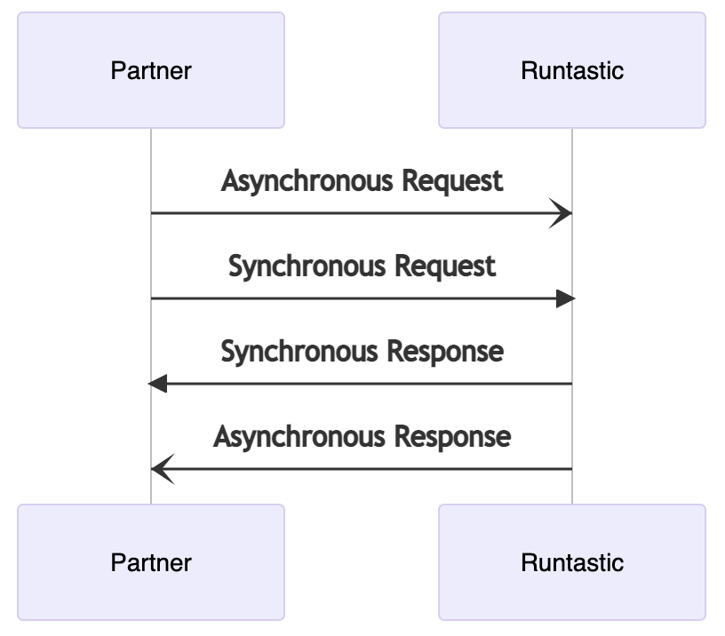

# Introduction

Welcome to adidas Running App Partner API documentation!

The Running App Partner API is a [REST](https://en.wikipedia.org/wiki/Representational_state_transfer) API. Request and response bodies are, in general, encoded in [JSON](https://en.wikipedia.org/wiki/JSON) format. It makes use of standard HTTP status codes and verbs.

All traffic to and from the API must use TLS. This means all API calls must be with the HTTPS scheme. The [webhook system](API/v0/webhooks.md) also only performs requests through HTTPS.
Also, all endpoints require authentication. See the [Authentication section](authentication/v1/index.md) for more information.

The base URL for all API endpoints is `https://partnerapi.runtastic.com`. As the current version of the API is a beta version, the prefix `/v0` will be used.

Before jumping in the integration itself, it's recommended that you read some patterns and tools used in the other pages.

Note that we do not provide client libraries for integrating with our API.

## Support

For questions, support or feedback please contact [partnerapi.digitalsports@adidas.com](mailto:partnerapi.digitalsports@adidas.com).

## Tools

For all the HTTP requests examples, we will use [HTTPie](https://httpie.org/). It's a HTTP client with a really intuitive and clean way to write requests, highly recommended.

## Documentation patterns

In some sections of the documentation, we'll represent placeholders around `{}`, where the name inside the curly brackets is a variable that would be already received in the presented flow.

The diagram flows use constant arrows to represent requests and dotted arrows to represent responses.

Sync requests will be represented with solid arrowheads and async requests with line arrowheads.

<!-- 
sequenceDiagram
Partner-)Running App: Asynchronous Request
Partner->>Running App: Synchronous Request
Running App->>Partner: Synchronous Response
Running App-)Partner: Asynchronous Response
-->
